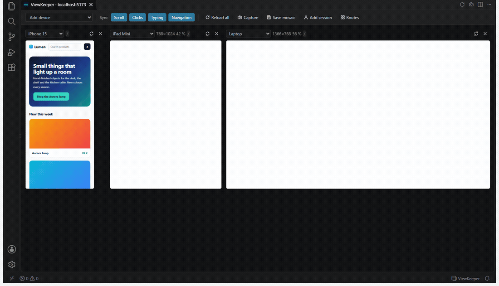
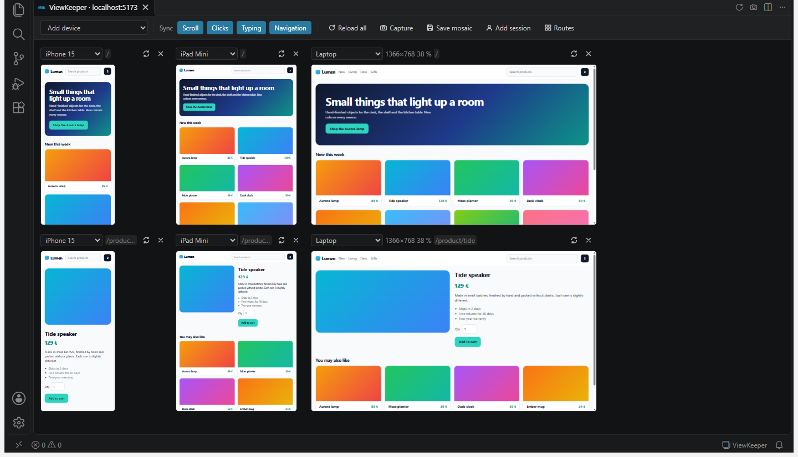

# ViewKeeper

**Tu servidor de desarrollo en varios dispositivos y rutas a la vez, dentro de VS Code. Lo que haces en una vista pasa en todas.**

Te desplazas en el móvil y la tableta y el portátil se desplazan con él. Escribes en un buscador y los otros dos se rellenan. Pulsas un enlace y todas las vistas te siguen. Funciona con la app que estás construyendo de verdad —Vite, Next.js, Astro, cualquier cosa en localhost—, con la recarga en caliente intacta, aunque tu app se niegue a dejarse incrustar y aunque haya que iniciar sesión.

[English](README.md)

## Instalar

[VS Code Marketplace](https://marketplace.visualstudio.com/items?itemName=argalla.viewkeeper) · [Open VSX](https://open-vsx.org/extension/argalla/viewkeeper) (Cursor, Windsurf, VSCodium) · o `code --install-extension argalla.viewkeeper`

Arranca tu servidor de desarrollo y pulsa **ViewKeeper** en la barra de estado. Lo encuentra solo.

## Qué hace

Todo es **gratis**.

- **Varios dispositivos uno al lado de otro**, cada uno a su tamaño CSS real: iPhone, Pixel, Galaxy, iPad, portátil, escritorio, o los tamaños que tú definas. Cualquiera se puede girar.
- **Todo sincronizado**: desplazamiento, clics, escritura y navegación. Cada cosa se puede apagar.
- **Matriz de rutas × dispositivos**: portada, ficha de producto y carrito, cada una en tres dispositivos, cada fila sincronizada por su cuenta. Lee las rutas de tu proyecto en Next.js (app y pages), SvelteKit, Astro, Nuxt o HTML suelto.
- **Sesiones lado a lado**: la misma pantalla como administrador y como cliente a la vez. Cada sesión tiene sus propias cookies y almacenamiento.
- **Captura**: un PNG por vista y una hoja de contactos con el mosaico entero, con la sesión iniciada, usando el Chrome, Edge o Brave que ya tienes. No descarga nada.
- **Mosaicos guardados** en `.vscode/viewkeeper.json`, para que todo el equipo abra las mismas pantallas.
- **La recarga en caliente sigue en caliente.** Vite y Next.js actualizan cada vista sin recargarla.
- **También con una API en otro puerto.** Si tu frontal llama a `localhost:3001` y el navegador lo bloquea dentro del mosaico, ViewKeeper te ofrece pasarlo por él.

## Por qué hace falta un proxy

Meter tu localhost en unos `<iframe>` es fácil. Que se sigan unos a otros no: eso necesita código corriendo dentro de tu página, y tu servidor de desarrollo no sirve el código de ViewKeeper. Y dentro de un panel del editor se rompen dos cosas más:

- **Las apps que no se dejan incrustar.** `X-Frame-Options` o `frame-ancestors` dejan el marco en blanco.
- **Iniciar sesión.** Dentro de un panel de VS Code tu página es un marco de terceros, y el navegador descarta toda cookie que no esté marcada `SameSite=None`. Lo medimos: sin ayuda no llega ni una cookie de sesión. Tu pantalla de entrada se queda en bucle.

Así que ViewKeeper pone un proxy pequeño en `127.0.0.1` entre las vistas y tu servidor. Añade un script corto a cada página, quita las cabeceras que impiden incrustar y reescribe las cookies para que sobrevivan. Ni tu servidor ni tu código se tocan; solo cambia lo que recibe la vista previa.

## Qué no es

- **No es un emulador.** Cada vista tiene el tamaño, el agente de usuario y el idioma del dispositivo tal como los ve JavaScript, y sin barra de desplazamiento en los móviles. No emula la densidad de píxeles ni los eventos táctiles, y tu servidor ve el agente de usuario del propio editor. Para emular un dispositivo exacto, el navegador integrado de VS Code lo hace bien.
- **Iniciar sesión a través de otro sitio** (redirecciones a Google, GitHub, Auth0) no cabe en una vista: el panel solo deja hablar a cada vista con tu servidor. Usa una cuenta de prueba local.
- **Por ahora, solo ventanas locales.** En una ventana remota (WSL, SSH, contenedores, Codespaces) las vistas no llegan al proxy, y ViewKeeper lo dice en vez de abrir un panel en blanco.
- **Durante la vista previa tu app corre algo distinta**: sin su Content-Security-Policy, con las cookies reescritas y desde otro origen. Para maquetar y probar comportamiento da igual; si estás depurando justo una de esas tres cosas, apaga `viewkeeper.relaxCsp` / `viewkeeper.fixCookies` o usa un navegador normal.
- Cuando dos vistas tienen maquetaciones muy distintas, un clic solo se repite si el elemento es de verdad el mismo (misma etiqueta, rol, nombre, enlace). Si no, esa vista no te sigue, antes que pulsar otro botón.

## Comandos

| Comando | |
|---|---|
| **ViewKeeper: Abrir mosaico de tu servidor de desarrollo** | También el botón de la barra de estado |
| **ViewKeeper: Abrir matriz de rutas × dispositivos** | Eliges rutas y dispositivos |
| **ViewKeeper: Añadir una celda con otra sesión** | La misma pantalla, otro usuario |
| **ViewKeeper: Guardar este mosaico en el proyecto** / **Abrir un mosaico guardado** | `.vscode/viewkeeper.json` |
| **ViewKeeper: Capturar el mosaico** / **(páginas enteras)** | PNG y hoja de contactos |
| **ViewKeeper: Recargar todas las celdas** | |
| **ViewKeeper: Diagnosticar** | Lo que el proxy vio y no pudo hacer |

La barra del propio panel añade dispositivos y enciende o apaga cada tipo de sincronización, y cada vista puede cambiar de dispositivo, girarse o cerrarse.

## Ajustes

| Ajuste | Por defecto | |
|---|---|---|
| `viewkeeper.defaultDevices` | `["iphone-15", "ipad-mini", "laptop"]` | Dispositivos de un mosaico nuevo |
| `viewkeeper.customDevices` | `[]` | Los tuyos: `{ "id", "name", "width", "height", "mobile" }` |
| `viewkeeper.apiOrigins` | `[]` | API en otros puertos locales que pasan por el proxy. Solo si ya admiten por CORS el origen de tu app |
| `viewkeeper.relaxCsp` | `true` | Quitar la CSP de tu app durante la vista previa |
| `viewkeeper.fixCookies` | `true` | Reescribir las cookies para poder iniciar sesión dentro del panel |
| `viewkeeper.browserPath` | `""` | Navegador para las capturas; si está vacío, lo busca |

## Privacidad y seguridad

Sin telemetría, sin cuenta y sin ninguna petición de red propia. El proxy solo escucha en `127.0.0.1`, solo sirve a las vistas del panel que lo abrió (un testigo aleatorio de 192 bits en una cookie), rechaza cualquier otro nombre de servidor y no admite peticiones lanzadas desde otras webs. Lo que escribes en una vista se reparte a las demás dentro del panel y nunca llega al host de la extensión. Detalles en [PRIVACY.es.md](PRIVACY.es.md); para avisar de una vulnerabilidad, [SECURITY.md](SECURITY.md).

El proxy y el motor de sincronización pasaron dos auditorías independientes antes de la primera versión, con un banco en navegador de 27 casos de ataque y comportamiento que corre en CI.

## Requisitos

VS Code 1.95 o posterior, una ventana local y un servidor de desarrollo en `http://localhost`. Para las capturas, Chrome, Edge, Brave o Chromium.

---

MIT · de [Argalla](https://github.com/TecniartGalicia) · Sin relación con Microsoft, Apple, Google ni Samsung; los nombres de dispositivos solo describen tamaños de pantalla.
