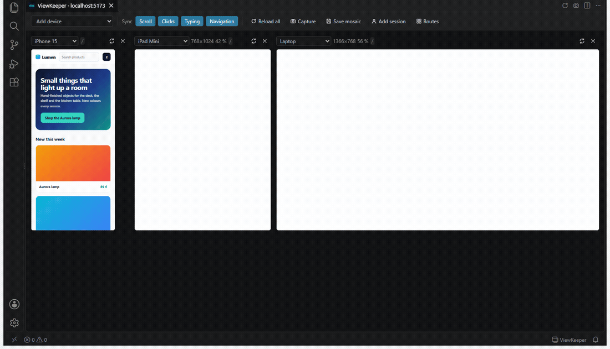
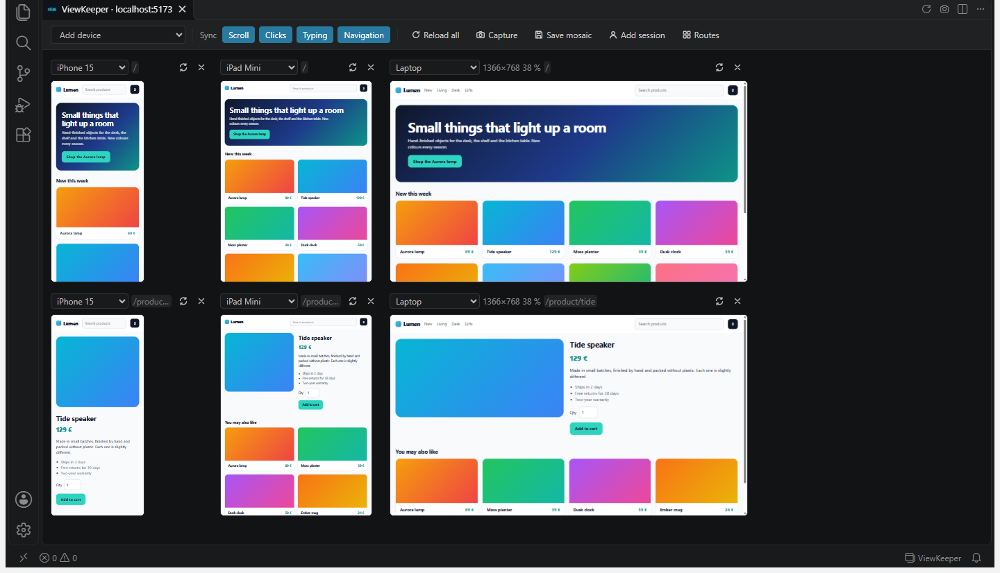

# ViewKeeper

**Your dev server on several devices and routes at once, inside VS Code. What you do in one view happens in all of them.**

Scroll the phone and the tablet and the laptop scroll with it. Type in one search box and the other two fill in. Click a link and every view follows. It works with the app you are actually building — Vite, Next.js, Astro, anything on localhost — with hot reload intact, even if your app refuses to be framed, and even if you need to sign in.

[Español](README.es.md)

## Install

[VS Code Marketplace](https://marketplace.visualstudio.com/items?itemName=argalla.viewkeeper) · [Open VSX](https://open-vsx.org/extension/argalla/viewkeeper) (Cursor, Windsurf, VSCodium) · or `code --install-extension argalla.viewkeeper`

Start your dev server, then click **ViewKeeper** in the status bar. It finds the server by itself.

## What you get

Everything is **free**.

- **Several devices side by side**, each at its real CSS size: iPhone, Pixel, Galaxy, iPad, laptop, desktop, or your own sizes. Rotate any of them.
- **Everything in sync**: scroll, clicks, typing and navigation. Each one can be switched off.
- **Route × device matrix**: home, product page and cart, each on three devices, each row in sync on its own. ViewKeeper reads your routes from Next.js (app and pages), SvelteKit, Astro, Nuxt or plain HTML.
- **Sessions side by side**: the same screen as an admin and as a customer at the same time. Each session has its own cookies and storage.
- **Capture**: one PNG per view plus a contact sheet of the whole mosaic, signed in, using the Chrome, Edge or Brave you already have. Nothing is downloaded.
- **Saved mosaics** in `.vscode/viewkeeper.json`, so the whole team opens the same set of screens.
- **Hot reload stays hot.** Vite and Next.js update every view in place without a full reload.
- **An API on another port works too.** If your frontend calls `localhost:3001` and the browser blocks it inside the mosaic, ViewKeeper offers to route it.

## Why this needed a proxy

Putting your localhost in a few `<iframe>`s is easy. Making them follow each other is not: that needs code running inside your page, and your dev server does not serve ViewKeeper's code. Two more things break inside an editor panel:

- **Apps that refuse to be framed.** `X-Frame-Options` or `frame-ancestors` turn the frame blank.
- **Sign-in.** Inside a VS Code panel your page is a third-party frame, and the browser drops every cookie that is not marked `SameSite=None`. We measured it: without help, not one session cookie arrives. Your login page loops.

So ViewKeeper runs a small proxy on `127.0.0.1` between the views and your dev server. It adds a short script to each page, removes the framing headers, and rewrites cookies so they survive. Your server and your code are never touched; only what the preview receives changes.

## What it is not

- **Not an emulator.** Each view has the device's size, user agent and language as JavaScript sees them, and no scrollbar on phones. It does not emulate pixel density or touch events, and your server sees the editor's own user agent. For exact emulation of one device, VS Code's built-in browser does that well.
- **Sign-in through another site** (Google, GitHub, Auth0 redirects) cannot happen inside a view: the panel only lets each view talk to your own dev server. Use a local test account.
- **Local windows only, for now.** In a remote window (WSL, SSH, containers, Codespaces) the views cannot reach the proxy, and ViewKeeper says so instead of opening a blank panel.
- **During the preview your app runs slightly differently**: without its Content-Security-Policy, with rewritten cookies, from another origin. That is fine for layout and behaviour; if you are debugging one of those three things, turn off `viewkeeper.relaxCsp` / `viewkeeper.fixCookies` or use a normal browser.
- **A deployed site works too**, with care: every click and keystroke is repeated in every view, so with real data turn off click and typing sync or use a test account. Sign-in through another site does not work (see above), an API on another domain rejects the preview origin, and links written with the full domain leave the mosaic.
- When two views have very different layouts, a click is only replayed if the element really is the same one (same tag, role, name, link). Otherwise that view simply does not follow, rather than pressing the wrong button.

## Commands

| Command | |
|---|---|
| **ViewKeeper: Open mosaic for your dev server** | Also the status bar button |
| **ViewKeeper: Open mosaic for a URL (local or deployed)…** | Any address with its path, also a deployed site; replaces the open mosaic. Also the **Address** button in the panel |
| **ViewKeeper: Open route × device matrix** | Pick routes and devices |
| **ViewKeeper: Add a cell with another session** | Same screen, another user |
| **ViewKeeper: Save this mosaic to the project** / **Open a saved mosaic** | `.vscode/viewkeeper.json` |
| **ViewKeeper: Capture the mosaic** / **(full pages)** | PNGs and a contact sheet |
| **ViewKeeper: Reload all cells** | |
| **ViewKeeper: Diagnose** | What the proxy saw and could not do |

The panel's own toolbar adds a device, switches each kind of sync on or off, and each view can change device, rotate or close.

## Settings

| Setting | Default | |
|---|---|---|
| `viewkeeper.defaultDevices` | `["iphone-15", "ipad-mini", "laptop"]` | Devices for a new mosaic |
| `viewkeeper.customDevices` | `[]` | Your own: `{ "id", "name", "width", "height", "mobile" }` |
| `viewkeeper.apiOrigins` | `[]` | APIs on other local ports to route through the proxy. Only used if they already allow your app's origin by CORS |
| `viewkeeper.relaxCsp` | `true` | Remove your app's CSP during the preview |
| `viewkeeper.fixCookies` | `true` | Rewrite cookies so sign-in works inside the panel |
| `viewkeeper.browserPath` | `""` | Browser for captures; found automatically if empty |

## Privacy and security

No telemetry, no account, no network request of its own. The proxy listens only on `127.0.0.1`, only serves the views of the panel that opened it (a random 192-bit token in a cookie), rejects any other host name, and refuses requests launched from other websites. What you type in a view is relayed to the other views inside the panel and never reaches the extension host. Details in [PRIVACY.md](PRIVACY.md); reporting a vulnerability in [SECURITY.md](SECURITY.md).

The proxy and the sync engine went through two independent audits before the first release, with a bench of 64 attack and behaviour cases (proxy, sync and the real panel in headless Chrome) that runs in CI.

## Requirements

VS Code 1.95 or later, a local window, and a dev server on `http://localhost`. For captures, Chrome, Edge, Brave or Chromium.

---

MIT · by [Argalla](https://github.com/TecniartGalicia) · Not affiliated with Microsoft, Apple, Google or Samsung; device names are used only to describe screen sizes.
